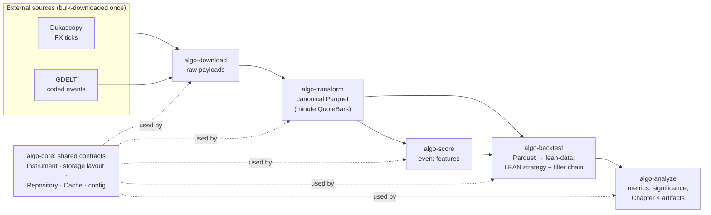

# Data-Driven Forex Trading: An Empirical Evaluation

Final research project (Trabalho de Conclusão de Curso) for the MBA in Artificial
Intelligence and Big Data (MBAIAe, ICMC/USP).

**Author:** Wellington Baltazar de Souza
**Advisor:** Profa. Dra. Carolina Toledo Ferraz
**Status:** final version, defended on 2026-10-10.

This repository holds two things side by side: the **written thesis**
(`monografia/`) and the **software** that produces its empirical results
(`algo-suite/`). This README is the entry point for a collaborator: what the
project is, what it found, how the repo is laid out, how to set each part up, and
how to work in it.

---

## What the work does

The thesis asks whether news-derived event features improve the risk-adjusted,
cost-adjusted performance of a Forex strategy over a price-only baseline. The
hypothesis (H1) is stated as falsifiable, and a rejection is itself a reportable
contribution.

- **Instrument:** EUR/USD, one-minute bars, Dukascopy tick data.
- **News signal:** GDELT 2.0 coded-event intensity (daily mean Goldstein score).
  Article-level sentiment scoring is not part of the reported experiments.
- **Window:** February 2015 to February 2017 (about two years), split
  chronologically into fitting, calibration and held-out simulation spans.
- **Strategies:** a price-only **baseline** and a **hybrid** that adds the event
  family, both replayed on a local LEAN engine under the same execution model and
  costs.
- **Result:** H1 is not supported. The hybrid did not outperform the baseline, and
  no strategy variant showed an edge. The thesis reports this as a reproducible
  negative result, with drift controls, multiple-comparison checks and the full
  search history. It does not claim that news has no value for Forex in general.

What was designed but not executed (other pairs, text sentiment, more news
sources, combinatorial cross-validation, rolling refits) is stated in the thesis
as future work and is not part of its evidence.

---

## How the software works

`algo-suite/` is a **uv workspace of six `algo-*` tools** sharing one library
(`algo-core`). It is a linear pipeline: each tool reads the previous stage's
durable artifact and writes its own, so any stage can be re-run in isolation.



The guiding principle is **agentic perception, deterministic execution**: model
outputs are computed once into features that are read deterministically at
backtest time, while the trade-decision layer is a rule-based, fully audited
filter chain. The two strategies are compared under the same protocol, and the
inference uses the stationary bootstrap, a deflated Sharpe ratio and permutation
tests rather than the absolute level of any one run.

Canonical **Parquet is the single source of truth**; the LEAN-native `lean-data/`
store and the feature cache are *derived* (materialized once, reused across a
sweep). See [`algo-suite/docs/architecture.md`](algo-suite/docs/architecture.md).

---

## Repository layout

```
.
├── README.md            # you are here
├── monografia/          # LaTeX thesis (USPSC/abntex2, English body, Resumo in pt-BR)
└── algo-suite/          # the software: a uv workspace of algo-* tools
    ├── PRD.md                 # product source of truth: vision, scope, roadmap
    ├── docs/                  # architecture · experiments · scope-cuts · technical-debt · stories
    ├── algo-core/  algo-download/  algo-transform/
    ├── algo-score/ algo-backtest/  algo-analyze/   (each holds its own SPEC.md)
    ├── algo-viewer/           # results viewer
    ├── experiments/  conf/  scripts/  tools/  tests/  mk/
    └── pyproject.toml   Makefile   README.md
```

The per-tool technical specs are **colocated** with the code as
`algo-suite/algo-<tool>/SPEC.md`, and the design corpus lives under
`algo-suite/docs/`.

---

## Getting started

The two parts are independent; set up whichever you are working on.

### The software (`algo-suite/`)

Prerequisites: [uv](https://docs.astral.sh/uv/), Python 3.11 (pinned), Docker
(for the LEAN engine).

```bash
cd algo-suite
make install      # uv sync --all-packages → one .venv at the workspace root
make check        # ruff + mypy(strict) + pytest (BDD)
uv run algo-download --help
```

See [`algo-suite/README.md`](algo-suite/README.md) for the pipeline, per-tool
guide, configuration and data model.

### The thesis (`monografia/`)

Toolchain: `latexmk` + `pdflatex` + `bibtex` (not biber) + `makeindex`.

```bash
cd monografia
make            # incremental build → build/monograph.pdf
make watch      # rebuild on save
make verify     # page count + undefined-citation scan
make pt-scan    # list leftover Portuguese-accented words (body is English)
```

The Portuguese AI-use declaration is the last appendix. To print a signature on
it, point `SIGNATURE_PNG` at an image before building (the image is never stored
in the repository; without it the signature line stays blank):

```bash
export SIGNATURE_PNG="$HOME/Pictures/my-signature.png"
make
```

Do **not** modify files under `monografia/classe/` (vendored USPSC class). The
layout follows the USPSC template (two-sided, Latin Modern); `monografia/main.tex`
documents each deviation.

---

## Documentation map

| Read this | For |
|---|---|
| `algo-suite/PRD.md` | product scope, roadmap and phases |
| `algo-suite/docs/architecture.md` | architecture, stack, conventions, spec template |
| `algo-suite/docs/scope-cuts.md` | what is explicitly out of the thesis |
| `algo-suite/docs/parquet-evaluation.md` | storage and compute model (Parquet source of truth, durable `lean-data/`, read-through cache) |
| `algo-suite/docs/experiments.md` | how experiments map to Chapter 4 artifacts |
| `algo-suite/docs/technical-debt.md` | deferred-debt ledger (blocker + unblock trigger per item) |
| `algo-suite/algo-<tool>/SPEC.md` | the contract for each tool |
| `monografia/final-research-project-proposal.pdf` | the original research proposal (the plan, not the final scope) |

Some of these documents still describe the initial plan (for example a second
currency pair and text sentiment). The thesis is the reference for what was
executed.

---

## Conventions (please follow when contributing)

- **New code lives under `algo-suite/`**, each tool a workspace member.
- **Every test is BDD, no exceptions**: Gherkin `.feature` + pytest-bdd step
  definitions under each tool's `tests/features/` / `tests/steps/`. Write the
  scenario first; never a plain `def test_…()` (not even for unit/pure logic).
- **Convention over configuration**: the suite runs zero-config; `conf/*.yaml`
  files exist only to override a default. Precedence: env (`ALGO_*`) >
  `conf/<tool>.yaml` > `conf/algo.yaml` > defaults. One `data_root`
  (`ALGO_DATA_ROOT`, default `algo-suite/data/`, created at run time and not tracked).
- **Code style**: SOLID, clean code, single-return value objects, no magic
  numbers, GoF patterns only where they remove duplication (architecture doc §13).
  `make check` (ruff + mypy strict + pytest) must pass.
- **Prose style**: no mid-sentence em-dash "asides" in the thesis, decks or docs
  (use commas, parentheses or a colon); the thesis body is English, in **American
  English** (spelling: `-ize`/`-ization`, `-or`, `artifact`, `analyze`, `center`,
  `license`, `modeling`) across prose, docs, comments and docstrings.
- **Bulk-download once, query locally**: no live API calls on the hot path.

---

## Working together

- Branch off `master` for every change and open a PR; the maintainer reviews and
  merges. Do not commit feature work straight to `master`.
- Keep each change scoped to one concern; update the colocated `SPEC.md` and the
  tool README when behavior changes.
- The author commits the thesis and merges; coordinate before large refactors of
  shared contracts in `algo-core` (they ripple across every tool).
